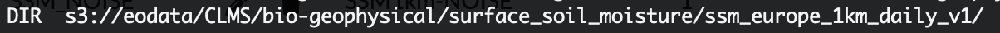
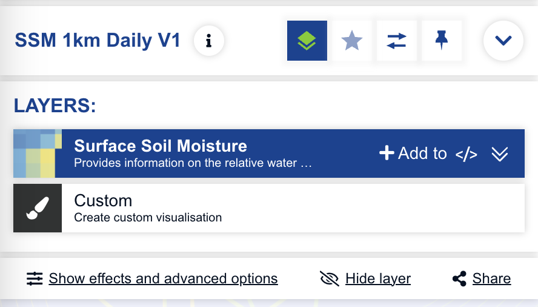
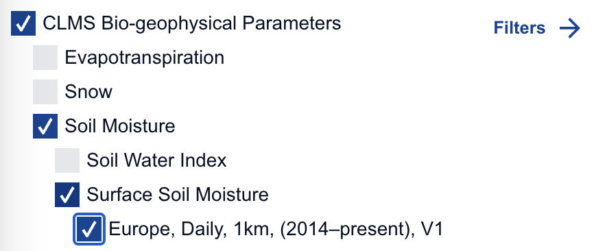
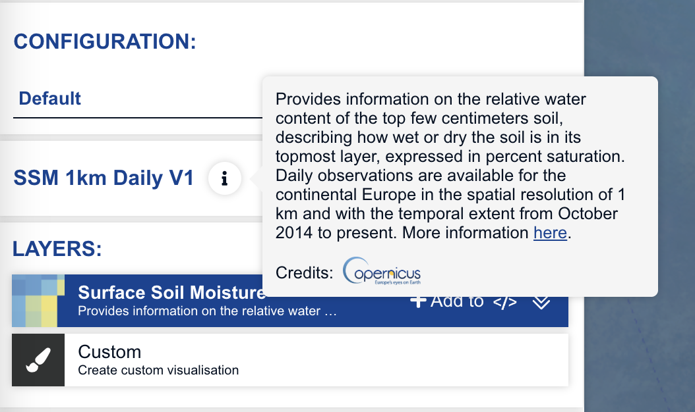
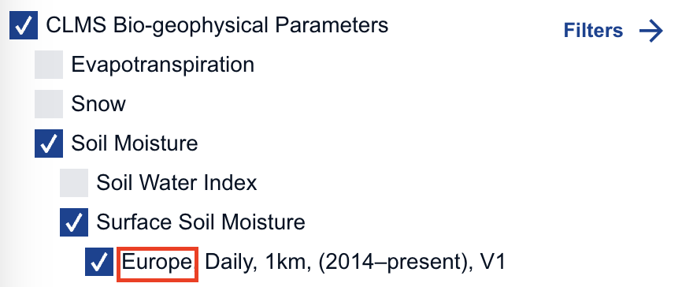
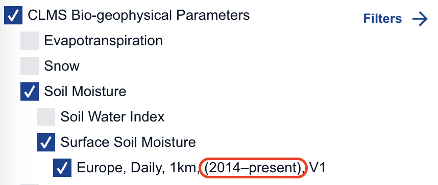
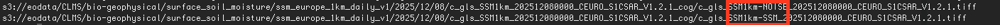
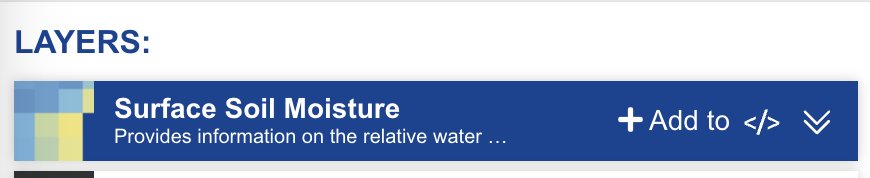
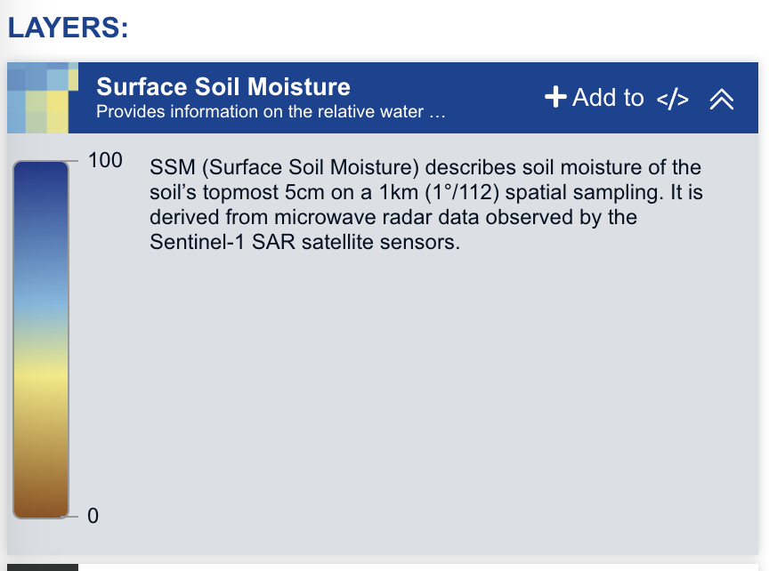

= Structure description of the proposed JSON scheme for CLMS collections (Browser integration)

== Full structure template

[source,json]
----
{
  "schemaVersion": "M.m.p",
  "eodataPath": "",
  "browserName": "",
  "browserSearchPath": "",
  "collectionDescription": "",
  "linkToCLMS": "",
  "spatialCoverage": "",
  "temporalExtent": {
    "start": "",
    "end": ""
  },
  "nominalSpatialResolution": "",
  "frequency": "",
  "thumbnailLink": "",
  "layers": [
    {
      "fileName": "",
      "layerBrowserName": "",
      "shortDescription": "",
      "longDescription": "",
      "colourMapLink": "",
      "legendLink": "",
      "units": "[unit]",
      "scale": "",
      "offSet": "",
      "display": 1
    }
  ]
}
----
https://github.com/copernicus-land/colourmaps-legends/tree/main/schemas/data_descriptors[source: data_descriptors schema]

IMPORTANT NOTE: Comments are not allowed in the file.

IMPORTANT NOTE: All values are strings, except `display`, which is a number (`1` or `0`). A field that does not apply is left as an empty string `""`, never omitted and never filled with `N/A` or `null`.

== Description of variables and rules to observe

In this section we will use the collection _ssm_europe_1km_daily_v1_ as the running example, unless stated otherwise.

=== schemaVersion

The version of the template the file follows, in the form `major.minor.patch`. New descriptors use the latest template available under `schemas/data_descriptors/`.

----
"schemaVersion": "0.0.4"
----

=== eodataPath

The path of the dataset in _eodata_. If the path is not available yet, request it through a JIRA ticket.

NOTE: the path has always to start with "s3://eodata/CLMS/.."

----
"eodataPath": "s3://eodata/CLMS/bio-geophysical/surface_soil_moisture/ssm_europe_1km_daily_v1"
----

=== browserName

The name that should appear in the Browser when visualising the product. This should follow the convention:

----
Product Resolution Frequency Version
----

* _Product_: the acronym of the product (SSM, NDVI, LAI, BA...). Use the full name only when no acronym is in use (e.g. "Surface Reflectance").
* _Resolution_: value and unit without space ("300m", "1km", "12.5km").
* _Frequency_: "daily", "10-daily", "monthly", "yearly", "hourly" (note the hyphen in "10-daily", which differs from the `frequency` field below).
* _Version_: "V" followed by the version number ("V1", "V2", "V2.3").

----
"browserName": "SSM 1km daily V1"
"browserName": "NDVI 300m 10-daily V3"
"browserName": "Surface Reflectance 300m daily V2.3"
----

=== browserSearchPath

The description of the structure to be implemented in the SEARCH tab of the Copernicus Browser. The root of the tree is "CLMS"; the path lists the nodes below it, separated by a comma and a space, down to the node that holds the collection.

----
"browserSearchPath": "CLMS Bio-geophysical Parameters, Soil Moisture, Surface Soil Moisture"
"browserSearchPath": "CLMS Bio-geophysical Parameters, Vegetation, Leaf Area Index"
----

=== collectionDescription

The description of the collection to be displayed when a user clicks on the information button in the VISUALISE tab. The reader already sees the collection name next to the button, so the text must go straight to the content.

Rules to observe:

. *Open with the variable as the subject of the first sentence.* Do not open with "Provides ...", "This dataset ...", "The dataset ..." or "The product ...". When the first sentence is a definition, the variable is the subject of the definition.
. *State, in this order and in the same sentence when possible:* the frequency ("daily", "every 10 days", "hourly"), the coverage ("at global scale", "for Europe", "for the Northern Hemisphere"), and the spatial resolution introduced by "at a spatial resolution of".
. *Resolution is written with the tilde, a space and the unit:* `+~1 km+`, `+~300 m+`, `+~12.5 km+`. Never `+~1km+`.
. *Coverage wording:* "at global scale" for global products, "for <area>" for regional ones ("for Europe", "for the Northern Hemisphere", "for Central Europe").
. *Optional additions*, after the sentence above: the source sensor ("derived from Sentinel-1 C-SAR"), the meaning of a parameter shared by several layers, the start of the time series.
. *Plain text only:* no markdown, no HTML, no hyperlinks. In particular, do not write "More information here" or the product URL: the link is given in `linkToCLMS`.
. *Length:* one to three sentences. Details that belong to a single layer go in the `longDescription` of that layer, not here.
. *Consistency between versions:* the descriptions of the versions of the same product (V1, V2, 1 km, 300 m, Europe, Global) use the same wording and differ only in the facts that change.

Examples (one-sentence form, the most common):

----
"collectionDescription": "Surface Soil Moisture estimates are provided daily for Europe, at a spatial resolution of ~1 km, derived from Sentinel-1 C-SAR."
"collectionDescription": "Soil Water Index is provided daily at global scale, at a spatial resolution of ~1 km, with different T-values representing different soil depth integration times."
"collectionDescription": "Burnt Area estimates are provided daily at global scale, at a spatial resolution of ~300 m."
"collectionDescription": "Land Surface Temperature estimates are provided hourly at global scale, at a spatial resolution of ~5 km."
----

Examples (definition first, then frequency, coverage and resolution):

----
"collectionDescription": "The Leaf Area Index (LAI) is defined as half the total green canopy area per unit of horizontal ground area. Estimates are produced every 10 days at global scale, at a spatial resolution of ~300 m."
"collectionDescription": "The Normalized Difference Vegetation Index is a spectral index quantifying the amount and vigour of vegetation. Every 10-days, estimates are available at global scale, at a spatial resolution of ~300 m."
----

Not acceptable:

----
"Provides daily Surface Soil Moisture estimates for Global, at a spatial resolution of ~1km. More information here."
----

(subject-less opening, "for Global" instead of "at global scale", `+~1km+` without space, leftover link text).

NOTE: the screenshot shows where the text appears in the Browser. The wording visible in it predates the rules above and must not be taken as a model.

=== linkToCLMS

The link to the product page on the CLMS portal. The Browser uses this field to add the link to the information pop-up; the URL and the sentence "More information here" must not be written in `collectionDescription`. If the product page is not available yet, request it through a JIRA ticket.

----
"linkToCLMS": "https://land.copernicus.eu/en/products/soil-moisture/daily-surface-soil-moisture-v1.0"
----

=== spatialCoverage

The spatial coverage of the collection. This information is used to build the name of the product in the SEARCH tab of the Browser. Use a short geographic name with initial capitals; values in use are "Global", "Europe", "Northern Hemisphere", "Pantropical", "Baltic".

----
"spatialCoverage": "Europe"
----

=== temporalExtent

The temporal coverage of the collection. This variable contains 2 attributes: **start** and **end**. This information is used to build the name of the product in the SEARCH tab of the Browser. Both values are expressed with the year only; `end` is "present" for a collection still in production.

----
"temporalExtent": {
  "start": "2014",
  "end": "present"
}
----

A discontinued collection carries the last year of production as `end`:

----
"temporalExtent": {
  "start": "1999",
  "end": "2020"
}
----

=== nominalSpatialResolution

The nominal spatial resolution of the dataset, value and unit without space, or "vector" for vector products.

----
"nominalSpatialResolution": "1km"
"nominalSpatialResolution": "300m"
"nominalSpatialResolution": "12.5km"
"nominalSpatialResolution": "vector"
----

=== frequency

The temporal frequency of the dataset, in lower case and without hyphen: "daily", "10daily", "hourly", "monthly", "yearly".

----
"frequency": "daily"
"frequency": "10daily"
----

=== thumbnailLink

The link to the thumbnail image in the CLMS git repository. The file is stored under `thumbnails/<dataset_name>/` and named after the dataset (see `docs/CLMS_Thumbnail_Specifications.adoc`). The field may be left empty when no thumbnail is available yet.

NOTE: the link must point to the dedicated folder in the CLMS git repository.

----
"thumbnailLink": "https://github.com/copernicus-land/colourmaps-legends/blob/main/thumbnails/ssm_europe_1km_daily_v1/ssm_europe_1km_daily_v1.jpg"
----

=== layers

An array containing the attributes for each layer contained in the collection.

IMPORTANT NOTE: The appearance order will be displayed in the CDSE browser. List the main variable(s) first, then uncertainty and ancillary layers (number of observations, semi-period lengths...), then quality flags.

==== fileName

The name of the Layer contained in the path of the COG. This enables us to identify the file in the _eodata_ storage. It is the only field that is not meant for display: it must match the file naming of the product exactly (case, separators) and is never "improved" for readability.

----
"fileName": "SSM1km-SSM"
"fileName": "NDVI300-NOBS"
----

==== layerBrowserName

The name of the Layer to be displayed in the Browser. It is a short, human-readable label in Title Case, without unit.

* The main variable of a product keeps the acronym by which the product is known: "SSM", "NDVI", "LAI", "DMP", "LST".
* Every other layer is spelled out in words: "Number of Observations", "Quality Flag", "Semi-period Length Before", not "NOBS", "QFLAG", "LENGTH_BEFORE".
* A layer derived from the main variable names it: "NDVI Uncertainty", "RMSE on LAI", "LST Error", "DMP Quality Flag".
* Layers that differ only by a parameter carry the parameter: "SWI T=2", "SWI T=5", "Surface Reflectance Oa02".

----
"layerBrowserName": "SSM"
"layerBrowserName": "Number of Observations"
"layerBrowserName": "Quality Flag"
"layerBrowserName": "SWI T=5"
----

Not acceptable: "NOBS", "QFLAG", "LENGTH_AFTER", "Rw".

==== shortDescription

The description of the layer that appears under the layer name in the Browser. This description should be less than 42 characters to be displayed in full.

* It is the full name of the quantity, written as a noun phrase: no verb, no final full stop.
* It spells out the acronym used in `layerBrowserName`: "SSM" / "Surface Soil Moisture", "NDVI" / "Normalized Difference Vegetation Index".
* For ancillary layers it says what the layer carries and for which variable: "Uncertainty on NDVI", "Quality flag associated to NDVI", "Day of burn detection".
* Sentence case, except for proper names and acronyms.

NOTE: no unit has to be added into the shortDescription

----
"shortDescription": "Surface Soil Moisture"
"shortDescription": "Normalized Difference Vegetation Index"
"shortDescription": "Uncertainty on NDVI"
"shortDescription": "Length of semi-period before the date"
----

Not acceptable: "Mean TSM" (acronym not spelled out), "Provides information on the relative water content of the soil" (a sentence, and too long to be displayed in full: see the screenshot above, where the text is cut after "relative water ...").

==== longDescription

The description of the layer that appears when the user expands the layer.

* One to three complete sentences, ending with a full stop. Plain text, no markdown.
* The first sentence names the quantity in full, with its acronym in parentheses if one is used, and says what it represents.
* The following sentences, when needed, say how the value is obtained and what its range or unit is.
* Do not repeat the collection-level information (frequency, coverage, resolution): it is already in `collectionDescription`.

NOTE: units can be added following the convention described in the units paragraph

----
"longDescription": "Surface Soil Moisture of the top 5 cm of soil, expressed as a degree of saturation (%)."
"longDescription": "Uncertainty of the NDVI is calculated by error propagation of the uncertainty associated to input spectral surface reflectances."
"longDescription": "This variable indicates the day of the year on which the burn is detected."
"longDescription": "Soil Water Index with characteristic time length T=5 days, expressed as degree of saturation (%)."
----

==== units

The unit of measure to be used in the layer.

Note 1: the unit must be enclosed in square brackets (e.g., "[m/km²]", "[%]")
Note 2: as the ultimate goal is to represent this information in a human-readable format, the convention to follow isn't the CF one (e.g., m km-2 → m/km²)
Note 3: the field is left empty only for layers without a unit (classes, flags).

----
"units": "[%]"
"units": "[K]"
"units": "[m²/m²]"
"units": "[kg/ha/day]"
"units": "[days]"
"units": ""            (quality flag)
----

==== colourMapLink

The link to the colourmap in the Github repository governing the display of the data in the Browser. The file is stored under `colourmaps/<dataset_name>/`; SLD is the reference format.

----
"colourMapLink": "https://github.com/copernicus-land/colourmaps-legends/blob/main/colourmaps/ssm_global_1km_daily_v2/ssm_global_1km_daily_v2.sld"
----

==== legendLink

The link to the legend in the Github repository that will be integrated in the layer description in the Browser. The file is stored under `legends/<dataset_name>/`. Left empty for layers that are not displayed or have no legend.

----
"legendLink": "https://github.com/copernicus-land/colourmaps-legends/blob/main/legends/ssm_global_1km_daily_v2/ssm_global_1km_daily_v2.png"
----

==== scale

The scaling factor for converting digital values to physical values. The physical value is computed as: `physical = digital * scale + offSet`. The field is mandatory: write "1" when no scaling applies.

----
"scale": "0.5"         (SSM: digital 0-200 becomes 0-100 %)
"scale": "1"           (no scaling)
----

==== offSet

The offset for converting digital values to physical values. The physical value is computed as: `physical = digital * scale + offSet`. The field is mandatory: write "0" when no offset applies.

----
"offSet": "0"
"offSet": "273.15"     (LST stored in degrees Celsius, displayed in K)
----

==== display

* `1` = the layer should be displayed in the Browser
* `0` = the layer is to be omitted in the Browser (e.g. quality flags without colourmap)

----
"display": 1
----
